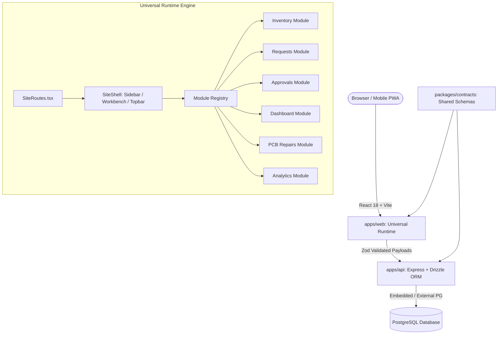

# OpsHub ⚡ Enterprise Operations & Fleet Command Platform

> **A high-velocity, multi-tenant operations cockpit powered by a config-driven universal runtime, schema-level time-travel rollbacks, cryptographic trust proofs, and a distinctive DevFest neo-brutalist design system.**

---

## 🌟 Executive Overview

OpsHub is an industrial-grade enterprise operating platform built to orchestrate multi-site warehousing, reverse logistics, depot repairs, quality assurance, and asset distribution.

Unlike traditional static dashboards, OpsHub operates on a **Config-Driven Universal Runtime**: every site, page layout, workflow transition, table schema, and permission tier is declared as versioned JSON configuration validated through Zod contracts. The UI dynamically derives navigation shells, module layouts, and data views at runtime without hardcoded site branching.

---

## 🎨 Design System: DevFest Neo-Brutalism

OpsHub pairs industrial utility with an unmissable, tactile aesthetic inspired by Google DevFest neo-brutalism:
- **Bold Linework**: High-contrast `2.5px` border outlines (`#1E293B`) with geometric structure.
- **Offset Box Shadows**: Crisp shadow offsets (`shadow-[4px_4px_0px_#1E293B]`) that compress on `:active` clicks for tactile physical feedback.
- **Signature Palette**: Electric Yellow (`#FBBC04`), Ultra Blue (`#4285F4`), Signal Red (`#EA4335`), Fresh Mint (`#34A853`), and Slate Canvas (`#F8FAFC`).
- **Cyber High-Contrast Dark Mode**: Toggle between light blueprint paper and deep OLED `#090D16` night mode with glowing neon indicators and custom scrollbars.
- **Micro-Interactions**: Monospace badge tags, live pulsing beacon indicators, and tactile audio-synthesized scan feedback.

---

## 🚀 Key Features & Innovations

### 1. ⌘K Global Command Palette (HUD)
- Invoke anywhere using `⌘K` or `Ctrl+K`.
- Instant fuzzy navigation across all provisioned fleet sites, child pages, and admin consoles.
- Direct quick actions: launch optical scanner, toggle dark/light theme, toggle real-time radar feed, or inspect cryptographic trust proofs.

### 2. Interactive Optical Barcode & QR Code Suite
- **Viewfinder Scanner Modal**: Animated sweeping laser beam, simulated multi-camera feed, Web Audio API synthesized acoustic beep (`880Hz` ➔ `1760Hz`), and manual SKU fallback.
- **Industrial QR Code Generator**: Generates vector SVG QR labels with SKU, bin coordinates, item title, and timestamp—ready for single-click thermal printer output.
- Deeply wired into **Inventory** (stock intake & label printing) and **Material Requests** (instant line-item scanner addition).

### 3. Real-Time Operations Telemetry Radar
- Live background event bus broadcasting dispatch events, low-stock warnings, approval milestones, and system alerts.
- Slide-out radar drawer with category filtering, sound toggles, and live unread notification badge on the universal navigation shell.

### 4. Smart Enterprise `DataTable` Engine
- **Live Search**: Client-side full-text search with instant highlight and match count badge.
- **Tri-State Column Sorting**: Sort by any text or numeric column with visual direction indicators.
- **Adaptive Pagination**: Jump between 10, 15, 25, 50, or All rows per page with page jump buttons.
- **Multi-Row Bulk Operations**: Row-level selection checkboxes, "Select All", and an animated floating action dock for bulk approvals and rejections.

### 5. Dynamic SLA Engine & Configurable Breach Monitors
- Configurable operational SLA thresholds (⚡ Demo 30s, 15m, 1h Default, 4h, 24h).
- Real-time countdown timer tracking pending supervisor approvals with color-coded breach warning badges (`CRITICAL BREACH`, `OVERDUE`, `ON TRACK`).

### 6. Executive Operations Cockpit & KPI Funnel
- **Live Dispatch Ticker Tape**: Animated horizontal marquee streaming fleet-wide metrics.
- **SVG Circular Progress Gauges**: Live SLA compliance percentages and inventory availability scores.
- **Material Request Pipeline Funnel**: Multi-stage progress visualizer (Submitted ➔ Approved ➔ In Transit ➔ Fulfilled).
- **One-Click Dispatch Export**: Instant Excel spreadsheet generation via backend streaming.

### 7. Time-Travel Schema Rewind & Audit Timeline
- Non-destructive configuration rollbacks with visual impact diffing before confirmation.
- Interactive mission timeline view in Releases, tracking actor IDs, semantic action tags, and schema version bumps.

### 8. Cryptographic Trust Console & Tamper Resistance
- Verifiable proof suite executing row-level consistency checks across sites and ledgers.
- Visual multi-stage proof runner with explicit textual and glyph-based verdicts.

---

## 🏗 System Architecture



### Repository Structure

```
opshub/
├── apps/
│   ├── api/                  # Express 5 backend with Drizzle ORM
│   │   ├── src/
│   │   │   ├── compiler/     # Configuration compiler & AST validator
│   │   │   ├── db/           # Drizzle schema, migrations, and seeders
│   │   │   ├── middleware/   # RLS context, auth, error handling
│   │   │   ├── routes/       # Auth, sites, releases, ops, builder routes
│   │   │   └── services/     # Verification engine, trust console, operations
│   │   └── tests/            # Unit & integration test suites
│   │
│   └── web/                  # React 18 client application
│       ├── src/
│       │   ├── app/          # Core App, router, authentication gates
│       │   ├── components/   # Neo-brutalist UI primitives, DataTable, HUD, Barcode
│       │   ├── features/     # Hub, Builder, Trust Console, Provisioning, Releases
│       │   ├── runtime/      # Universal Renderer, registry, SiteShell variants
│       │   └── stores/       # Zustand activity feed & theme stores
│       └── tests/            # 97 Vitest unit & architecture invariant tests
│
└── packages/
    └── contracts/            # Single source of truth: Zod schemas & TypeScript types
```

---

## ⚡ Quickstart Guide

### Prerequisites
- **Node.js**: `v20.x` or later
- **npm**: `v10.x` or later
- **OS**: Windows, macOS, or Linux

### 1. Installation
```bash
# Clone the repository and install all workspace dependencies
git clone <repo-url> opshub
cd opshub
npm install
```

### 2. Start Embedded PostgreSQL
OpsHub comes with an embedded zero-configuration PostgreSQL instance for local development:
```bash
npm run db:embedded
```
*Leave this terminal running. The database runs on port `5433` and seeds sample fleet data automatically.*

### 3. Start Development Servers
In a new terminal window:
```bash
npm run dev
```
- **Web Cockpit**: `http://localhost:5173`
- **Backend API**: `http://localhost:4000`

---

## 🔑 Demo Credentials

OpsHub comes pre-seeded with multi-role accounts:

| Role | Email | Password | Access Scope |
| :--- | :--- | :--- | :--- |
| **Platform Admin** | `admin@opshub.local` | `opshub-dev-1` | Global Fleet, Site Provisioning, Trust Console, Config Builder |
| **Site Supervisor** | `supervisor@opshub.local` | `opshub-dev-1` | Operational Approvals, Releases, Material Dispatches |
| **Operator** | `operator@opshub.local` | `opshub-dev-1` | Inventory Scanning, Intake, Request Submissions |

---

## 🧪 Testing & Architecture Invariants

OpsHub enforces strict architectural boundaries to guarantee that the universal renderer remains completely decoupled from individual site identities.

```bash
# Run web unit tests (97 tests)
npm --prefix apps/web run test:unit

# Run API unit tests (40 tests)
npm --prefix apps/api run test:unit

# Run full production build with chunk splitting
npm --prefix apps/web run build
```

### Architecture Invariant Test: Zero Hardcoded Slugs
`apps/web/tests/architecture.test.ts` scans the entire frontend codebase using AST analysis to verify that no seeded site slugs (`"central-stores"`, `"service-centre"`, `"distribution"`) appear in rendering code or conditional logic. Every site is 100% config-driven.

---

## 🛡 Security & Compliance

- **Row-Level Security (RLS)**: Express middleware injects tenant context (`siteId`) into Drizzle ORM transactions.
- **Cryptographic Audit Log**: Every configuration release and status transition records actor ID, timestamp, and content SHA-256 digest.
- **Tamper Resistance Proofs**: Verifiable state proofs ensure no inventory records or workflows have been altered out-of-band.

---

## 📄 License
MIT © 2026 OpsHub Technologies. All rights reserved.
